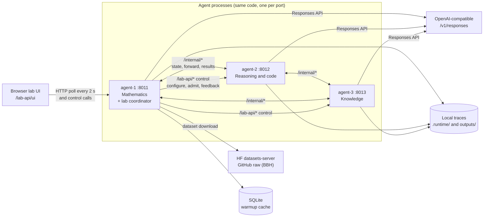
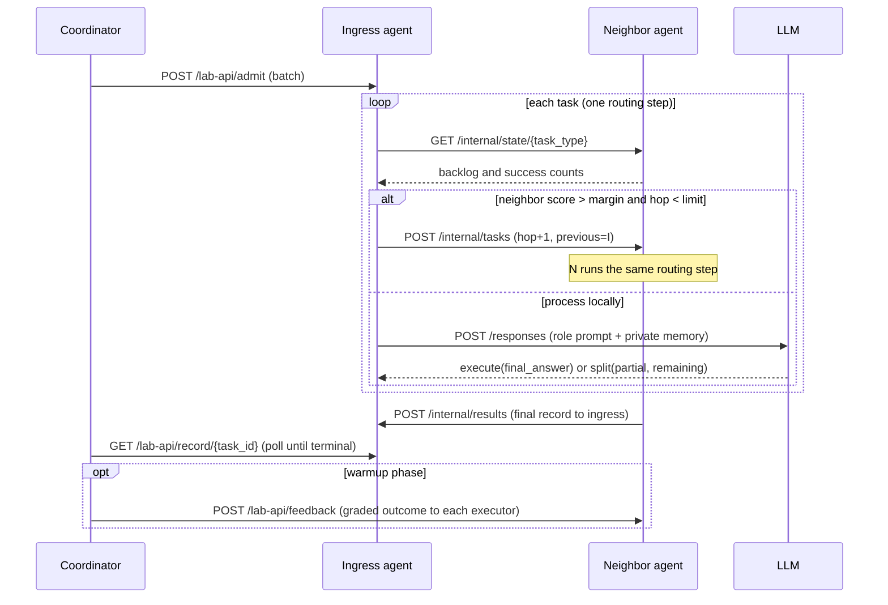

# DEALS: Decentralized Expertise-Aware Routing Lab

Status: **working prototype with pilot-scale evidence.** The main paired run covers MATH, BBH and MMLU-Pro with 25 test cases each (75 paired cases, exact McNemar p = 0.021). That supports a *direction*, not a full reproduction of the paper's claims.

A local lab that implements DEALS-style decentralized routing between LLM agents and compares it with a centralized agentic-RAG baseline on MATH, BBH and MMLU-Pro. Three agent processes route tasks among themselves using only queue backlog and verified per-type success rates. A browser lab runs paired evaluations, streams live progress, and saves auditable per-task traces.

---

## Contents

1. [Research question](#research-question)
2. [Sources and scope](#sources-and-scope)
3. [Architecture](#architecture)
4. [Routing algorithm](#routing-algorithm)
5. [Evaluation protocol](#evaluation-protocol)
6. [Communication matrix](#communication-matrix)
7. [API reference](#api-reference)
8. [Configuration](#configuration)
9. [Setup and running](#setup-and-running)
10. [Benchmarks](#benchmarks)
11. [Interpretation and limitations](#interpretation-and-limitations)
12. [Testing](#testing)
13. [Repository layout](#repository-layout)
14. [Security and data handling](#security-and-data-handling)

---

## Research question

Can agents that **route work among themselves**, using only local queue backlog and verified per-type success rates, match or beat a **centralized planner → retrieval → executor → reviewer** pipeline on accuracy, token cost, latency and throughput, without a dedicated router model or extra LLM calls for agent selection?

**Expectation before testing.** If expertise-aware forwarding works, DEALS should:
- send tasks toward agents with higher verified success on that task type;
- use fewer tokens per task, because there are no planner or reviewer calls;
- show lower latency and higher throughput, because there is no central bottleneck;
- at least match baseline accuracy.

Evidence against the expectation would be equal or lower accuracy with no throughput gain, or routing that ignores learned quality.

## Sources and scope

- **Paper:** *DEALS: Decentralized Expertise-Aware Load Serving for Multi-Agent LLM Systems*. J. Huang, W. Wang, Y. Yin, A. Velasquez, J. Liu. arXiv, 2026. <!-- TODO: add the arXiv ID/URL and version used. -->
- **Implementation type:** paper-inspired prototype, not a reproduction.
- **Implemented:**
  - equations 1–3: backlog, Beta-smoothed quality, routing score;
  - Algorithm 1 routing decision: margin, hop limit, no immediate return to the sender, deterministic tie-break;
  - task forwarding between agents, result delivery to the ingress agent, and the execute/split continuation contract;
  - warmup (learning) and test (frozen) phases, with private per-agent verified memory.
- **Known deviations from the paper:**

| Area | Paper | This lab |
|---|---|---|
| Models | Open models (e.g. Qwen, Mistral, Llama) | OpenAI API models: `gpt-5-nano`, `gpt-6-luna`, `gpt-4o-mini` |
| Retriever | Embedding retriever | Lexical cosine + execution-time factor (not BGE); `configs/models/embedding.json` is not used by the lab yet |
| Baseline | Paper baselines (e.g. AgentNet) | Custom centralized agentic RAG (planner → shared retrieval → executor → reviewer) |
| Case IDs | Paper's released splits | Public dataset samples, seed 17; not the paper's released case IDs |
| Scale | Full benchmarks | Pilot runs of 12–25 test cases per dataset (main run: 25 × 3 datasets) |
| Agent pool | Per paper | 3 agents, fully connected graph, capacity 2 |

- **Upstream data:** MATH (`EleutherAI/hendrycks_math`), BIG-Bench Hard (`suzgunmirac/BIG-Bench-Hard`), MMLU-Pro (`TIGER-Lab/MMLU-Pro`). Data is downloaded at runtime and **not** committed. Check each upstream licence before redistributing.

## Architecture

Every agent runs the same FastAPI app (`services/agent_runtime`). Agent-1 (the first entry in `configs/agents/local.json`) also acts as the **lab coordinator**: it serves the UI, drives experiments and aggregates state. The coordinator role is a lab convenience. DEALS routing itself has no leader.



### Components

| Component | Path | Responsibility |
|---|---|---|
| Routing math | `packages/deals_core/routing.py` | Equations 1–3 and the Algorithm 1 decision (pure, exact `Fraction` arithmetic) |
| Retrieval | `packages/deals_core/retrieval.py` | Private verified memory: cosine plus time factor, threshold, top-3 |
| Contracts | `packages/contracts` | Immutable `TaskEnvelope`, execute/split outputs, token-usage accounting |
| Agent state | `services/agent_runtime/src/state.py` | Per-type queues, in-flight slots, capacity, warmup/test phase |
| Runtime | `src/runtime.py` | Admission, routing step, local execution, split continuation |
| Peer mesh | `src/network.py` | Neighbor snapshots, forwarding, result delivery, graph validation |
| Model executor | `src/model_executor.py` | Structured Responses API calls (`execute` or `split`), per-call usage logs |
| Lab | `src/research_lab.py` | Datasets, grading, DEALS/baseline runners, reports, warmup cache wiring |
| Controls | `src/lab_controls.py` | Cooperative stop, clear history, benchmark-only jobs |
| Downloads and live grading | `src/lab_download_fix.py` | Resumable, rate-limited downloads; `/live-grade` |
| Warmup cache | `src/warmup_cache.py` | SQLite store for learned warmup state, keyed by configuration fingerprint |
| Lab UI | `apps/frontend/research-lab.html` | Controls, live evaluation panel, live paired comparison, traces |

### Task lifecycle (DEALS)



## Routing algorithm

For task type τ, agent *i* and direct neighbor *j*:

$$B_i^{\tau} = Q_i^{\tau} + F_i^{\tau} \qquad \text{(queued + in-flight)}$$

$$q_i^{\tau} = \frac{S_i^{\tau} + \alpha}{S_i^{\tau} + U_i^{\tau} + \alpha + \beta} \qquad \text{(Beta-smoothed verified success)}$$

$$R_{ij}^{\tau} = \left(B_i^{\tau} - B_j^{\tau}\right) + V\left(q_j^{\tau} - q_i^{\tau}\right)$$

Agent *i* forwards to the eligible neighbor with the largest *R* only if *R* > margin, `hop_count < hop_limit`, and the neighbor is not the agent that just sent the task. Otherwise it processes the task locally. Ties go to the lowest agent index. Defaults: `V = 80`, `margin = 1`, `hop_limit = 3`, `α = β = 1`.

- **Warmup:** graded outcomes update *S*/*U* for every agent that executed the task. Correct answers are added to that agent's **private** memory (at most 40 items).
- **Test:** quality counts and memory are **frozen**. `/feedback` is rejected during test.

## Evaluation protocol

| Aspect | DEALS | Agentic RAG baseline |
|---|---|---|
| Entry | Random ingress agent per task, weighted per task type (seeded) | Always agent-1 |
| Agent selection | Decentralized routing (above) | Central LLM planner picks one executor |
| Retrieval | Executor's private verified memory | Shared memory of graded-correct warmup answers |
| Extra LLM calls | None | Planner and reviewer calls on every task |
| Learning in warmup | Per-agent quality and private memory | Shared retrieval memory |

- **Pairing:** both systems run the **same** test cases. The comparison card pairs reports with the same run ID and case-set hash.
- **Grading:** conservative normalized exact match. It handles `\boxed{}`, `FINAL:` prefixes, math delimiters, `\frac`/`\dfrac`, `\text{}`, degree and percent signs, and trailing unit words. The same grader is used for warmup feedback, live accuracy and final reports.
- **Tokens:** provider-reported input + output tokens from **all attempted calls**: planner, execution, split, retrieval prompt, review, and failed calls whose usage was measured. A step's token total is `null` if any call lacks provider usage.
- **Latency:** time from admission to terminal state. For the baseline, it is measured from the step start through the review pass. **Throughput:** cases ÷ step elapsed seconds.
- **Warmup cache:** the warmup runs once per configuration and is stored in SQLite (`.runtime/warmup_cache.sqlite3`):
  - stored state: per-agent quality counts and private memory for DEALS; shared memory for the baseline;
  - cache key: a SHA-256 fingerprint of the dataset, system, exact warmup case IDs, agent models, role prompts, routing settings, executor settings, and the source code of the grader, retriever and baseline;
  - any change produces a new key, so a stale warmup is never reused;
  - each report's `warmup` field records `fresh` or `cache` with that key.
- **Run sizes:** the UI chooses **test tasks** per dataset (12 / 25 / 50 / 100 / all) and the **warmup size** (12 / 50 / 100 / all) independently. Cases are taken in manifest order, so a given size always selects the same cases.
- **Dataset sampling (seed 17):**

| Dataset | Warmup | Test | Types | Sampling |
|---|---|---|---|---|
| MATH | 700 | 140 | 7 | Per subject: 100 from train, 20 from test |
| BBH | 627 | 100 | 20 | Per task: 5 test, 31–32 warmup |
| MMLU-Pro | 200 | 100 | 5 | Per subject (biology, CS, history, law, math): 40 warmup, 20 test |

Warmup and test are checked to be disjoint, both by case ID and by prompt hash.

## Communication matrix

### Who talks to whom

| From ↓ / To → | Browser UI | agent-1 (coordinator) | agent-2 / agent-3 | LLM provider | Dataset hosts | SQLite cache | Local disk |
|---|---|---|---|---|---|---|---|
| **Browser UI** | — | `/lab-api/*` (poll and control) | — | — | — | — | — |
| **agent-1** | JSON responses | self-calls via `/lab-api/*` | `/lab-api/*` control + `/internal/*` peer | `/responses` | HF datasets-server, GitHub raw | read/write | traces, reports |
| **agent-2 / agent-3** | — | `/internal/*` peer | `/internal/*` peer | `/responses` | — | — | traces |

Peer edges come from `configs/routing/graph.json` (fully connected by default). Agents reject peer traffic from senders that aren't graph neighbors.

### Message catalogue

| # | From → To | Method and endpoint | Payload / purpose | When |
|---|---|---|---|---|
| 1 | UI → coordinator | `GET /lab-api/state` | Nodes, graph, last 200 tasks, jobs, dataset readiness, reports, controls | Every 2 s |
| 2 | UI → coordinator | `POST /lab-api/jobs` | `{mode: benchmark, datasets, test_size, warmup_size, fresh_warmup}` | Run paired evaluation |
| 3 | UI → coordinator | `POST /lab-api/stop` | `{job_id}`: cooperative stop | Stop evaluation |
| 4 | UI → coordinator | `POST /lab-api/history/clear` | Clear traces, reports and in-memory learned state | Clear history |
| 5 | UI → coordinator | `POST /lab-api/datasets`, `/datasets/stop` | Download, resume or import a split; stop downloads | Dataset cards |
| 6 | UI → coordinator | `POST /lab-api/live-grade` | `{items:[{key, case_id, answer}]}` → correct/incorrect | During test steps |
| 7 | UI → coordinator | `GET /lab-api/warmup-cache`, `POST /warmup-cache/clear` | List or clear cached warmups | Page load, after runs |
| 8 | Coordinator → all agents | `GET /lab-api/node` | Health, model, role, per-type snapshots, backlog history | Before each step and for live state |
| 9 | Coordinator → all agents | `POST /lab-api/configure` | `{experiment, phase}`; refused if the node has outstanding work | Start of each warmup or test step |
| 10 | Coordinator → ingress agent | `POST /lab-api/admit` | Batch of `{prompt, task_type, lab:{job, case_id, system, phase}}` | Each step / pass |
| 11 | Coordinator → owning agent | `GET /lab-api/record/{task_id}` | Poll the task record until terminal | Every 0.4 s while a step runs |
| 12 | Coordinator → all agents | `GET /lab-api/records` | Last 200 records, for UI aggregation | With `/state` |
| 13 | Coordinator → executors | `POST /lab-api/feedback` | `{key, correct, type, prompt, answer, seconds}` | DEALS warmup only |
| 14 | Coordinator → all agents | `POST /lab-api/learned/export` / `learned/load` | Read or install learned warmup state for an experiment | Cache store / cache hit |
| 15 | Coordinator → all agents | `POST /lab-api/control/stop-node`, `/control/history-node` | Cancel queued work for a job; clear node history | Stop / clear |
| 16 | Agent → neighbor | `GET /internal/state/{task_type}` | Neighbor's queued, in-flight, successes, failures | Every routing step |
| 17 | Agent → neighbor | `POST /internal/tasks` | Forwarded `TaskEnvelope` (hop+1, previous agent, continuation) | Routing decides to forward |
| 18 | Executor → ingress agent | `POST /internal/results` | Terminal task record (result, steps, calls, usage) | Task completes or fails remotely |
| 19 | Agent → LLM | `POST {base_url}/responses` | Strict JSON schema (`execute` or `split`), role prompt, retrieved examples | Local execution |
| 20 | Coordinator → dataset hosts | `GET datasets-server.huggingface.co/rows`, `raw.githubusercontent.com` | Paged, rate-limited, cached download | Dataset download |

## API reference

All agents serve the endpoints above. Some extra local endpoints exist:
- `/health`, `/tasks`, `/tasks/{id}`: direct submission;
- `/dashboard-api/*` and `/`: the older static console in `apps/frontend/index.html`.

The research lab UI is at `http://127.0.0.1:8011/lab-api/ui`. FastAPI's interactive docs are at `http://127.0.0.1:8011/docs`.

## Configuration

| File | Contents |
|---|---|
| `.env` (from `.env.example`) | `OPENAI_API_KEY`. Never committed. |
| `configs/agents/local.json` | Provider, base URL, key variable name; per agent: `agent_id`, `model`, `port`. The first agent is the lab coordinator. |
| `configs/agents/skills.json` | Role name, skills and system prompt per agent |
| `configs/routing/graph.json` | Directed neighbor lists (peer graph) |
| `configs/experiments/local.json` | `run_id`, per-type capacity, task types, routing parameters `V`, margin, hop limit, α, β |
| `configs/models/execution.json` | `split_limit`, `max_output_tokens`, `timeout_seconds`, per-model reasoning effort |
| `configs/models/embedding.json` | Embedding settings used by `scripts/check_embedding.py` (not by the lab retriever yet) |

## Setup and running

Requirements: Python **3.12+**, an OpenAI-compatible API key, and macOS/Linux with `bash`.

```bash
cd projects/deals-expertise-aware-routing

# 1. Environment (one venv for the agent runtime; installs the local packages)
python3.12 -m venv services/agent_runtime/.venv
(cd services/agent_runtime && .venv/bin/pip install -r requirements-api.txt)

# 2. Credentials
cp .env.example .env        # then set OPENAI_API_KEY in .env

# 3. Optional checks
services/agent_runtime/.venv/bin/python scripts/check_models.py
services/agent_runtime/.venv/bin/python scripts/check_agent_network.py

# 4. Start all agents (Ctrl+C stops all of them)
bash scripts/run_research_lab.sh
```

Then open **http://127.0.0.1:8011/lab-api/ui** and:

1. **Load** each dataset from its card. This downloads into `data/lab/` and is resumable.
2. Choose **Datasets**, **Test tasks** and **Warmup (cached)**. Tick **Re-run warmup** only to force a new warmup.
3. Click **Run paired evaluation →**.
   - The **Live evaluation** panel shows step progress, per-agent load and recent tasks.
   - The **paired comparison** card fills in live during test steps.
4. Reports are written to `outputs/<job>-<dataset>-<system>-<phase>/{results,summary}.json`. Task and call traces go to `.runtime/agents/<agent>/`.

The first run for a given dataset and warmup size performs the warmup and caches it. Later runs go **straight to the test steps**. To evaluate more cases without re-warming, change only **Test tasks**.

## Benchmarks

All numbers come from the `summary.json` files in [`results/`](results/). Every run uses the 3-agent heterogeneous pool (`gpt-5-nano`, `gpt-6-luna`, `gpt-4o-mini`), default routing (`V=80`, margin 1, hop limit 3) and seed-17 dataset samples. Test cases are taken in manifest order, so runs with the same test size use the **same cases**.

### Main result: `lab-9f2c3916ed` (all three datasets, 25 test cases each)

| Dataset | System | Accuracy | Tokens / case | Median latency | Throughput (tasks/s) | Failed | Forwards | Warmup |
|---|---|---|---|---|---|---|---|---|
| MATH | **DEALS** | **32.0%** | **403** | **6.9 s** | **1.444** | 1 | 14 | 12, fresh |
| MATH | Agentic RAG | 20.0% | 1,395 | 77.3 s | 0.264 | 2 | 0 | 12, fresh |
| BBH | **DEALS** | **48.0%** | **489** | **7.1 s** | **1.530** | 0 | 9 | 12, fresh |
| BBH | Agentic RAG | 40.0% | 1,598 | 69.9 s | 0.304 | 1 | 0 | 12, fresh |
| MMLU-Pro | **DEALS** | **44.0%** | **936** | **12.3 s** | **0.983** | 0 | 20 | 12, cached |
| MMLU-Pro | Agentic RAG | 24.0% | 2,790 | 63.0 s | 0.330 | 2 | 0 | 12, cached |
| **Pooled (n = 75)** | **DEALS** | **41.3%** (31/75) | **609** | | | 1 | 43 | |
| **Pooled (n = 75)** | Agentic RAG | 28.0% (21/75) | 1,928 | | | 5 | 0 | |

**Paired significance (same 75 cases):**

| | DEALS-only correct | RAG-only correct | Both correct |
|---|---|---|---|
| MATH | 4 | 1 | 4 |
| BBH | 4 | 2 | 8 |
| MMLU-Pro | 5 | 0 | 6 |
| **Pooled** | **13** | **3** | 18 |

- Exact two-sided McNemar test on the pooled discordant pairs: **p = 0.021**.
- Wilson 95% intervals: DEALS 30.9–52.6%, agentic RAG 19.1–39.0%. The intervals overlap.
- The per-dataset differences are not significant on their own at n = 25.

The MMLU-Pro warmup in this run was **loaded from the SQLite cache** (created by `lab-186a8e2bb6`, same fingerprint). The DEALS test prompts, and so the input tokens (22,585), are identical to `lab-186a8e2bb6`. That confirms the cached private memory was restored exactly.

### Repeat on the same MMLU-Pro cases (same cached warmup)

| Run | System | Accuracy | Tokens / case | Median latency | Throughput | Failed |
|---|---|---|---|---|---|---|
| `lab-186a8e2bb6` | DEALS | 52.0% | 936 | 12.1 s | 1.024 | 0 |
| `lab-9f2c3916ed` | DEALS | 44.0% | 936 | 12.3 s | 0.983 | 0 |
| `lab-186a8e2bb6` | Agentic RAG | 32.0% | 2,790 | 89.1 s | 0.246 | 1 |
| `lab-9f2c3916ed` | Agentic RAG | 24.0% | 2,790 | 63.0 s | 0.330 | 2 |

The same cases, the same warmup state and the same prompts still give **±8 percentage points of run-to-run variation** for both systems. That variation comes from LLM sampling and from which agent each task reaches. The DEALS lead (+20 points) was the same in both runs.

### Warmup steps

| Run | Dataset | System | n | Accuracy | Tokens / case | Failed |
|---|---|---|---|---|---|---|
| `lab-9f2c3916ed` | MATH | DEALS | 12 | 25.0% | 448 | 0 |
| `lab-9f2c3916ed` | MATH | Agentic RAG | 12 | 0.0% | 1,536 | 0 |
| `lab-9f2c3916ed` | BBH | DEALS | 12 | 25.0% | 461 | 0 |
| `lab-9f2c3916ed` | BBH | Agentic RAG | 12 | 8.3% | 1,809 | 3 |
| `lab-186a8e2bb6` | MMLU-Pro | DEALS | 12 | 25.0% | 775 | 0 |
| `lab-186a8e2bb6` | MMLU-Pro | Agentic RAG | 12 | 0.0% | 2,488 | 1 |

### Earlier pilot and incomplete runs

| Run | Dataset | Test n | DEALS | Agentic RAG | Note |
|---|---|---|---|---|---|
| `lab-9f3ae1ef52` | MMLU-Pro | 12 | 58.3%, 872 tok/case | 16.7%, 2,566 tok/case | Before the warmup cache and the failed-call token fix; provider latency was high during this run (DEALS median 80.7 s) |
| `lab-e240319d7d` | MATH | 12 | 25.0%, 387 tok/case | — | Stopped before the baseline steps; no paired comparison |

Earlier development runs (MATH and BBH pairs before these) are **not reported**: their artifacts were deleted by *Clear history*, and they used an earlier grader and token accounting.

### What was measured, and how

- **Tokens:** provider-reported usage of every attempted call, including failed calls with measured usage.
- **Latency:** the baseline makes **three sequential LLM passes** (plan, execute, review), each waiting for its whole batch, so part of its latency and throughput gap is structural. DEALS makes one routed execution per task.
- **Cached warmups** add no warmup tokens or time to a run. Each report's `warmup` field records the cache key and the run that produced the warmup.

## Interpretation and limitations

**What the evidence supports.** On the same 75 test cases across MATH, BBH and MMLU-Pro, DEALS beat the centralized agentic-RAG baseline:
- accuracy 41.3% vs 28.0% (exact McNemar p = 0.021 on the pooled pairs);
- about 3.2× fewer tokens per case;
- about 5–11× lower median latency and higher throughput on every dataset;
- 1 failure vs 5.

The direction matched on all three datasets and in the MMLU-Pro repeat. Learned quality drives test-time routing: in this run, 80 of 118 DEALS routing decisions used non-zero warmup statistics.

**What remains uncertain:**
- **Sample size:** 25 test cases per dataset and one main run. Per-dataset differences are within noise, the pooled confidence intervals overlap, and repeats vary by ±8 points.
- **Model confound:** the three agents use different models, so accuracy partly reflects which model received each task, not only the routing policy.
- **Baseline design:** the custom agentic-RAG baseline is not the paper's baseline. Its planner and reviewer add calls and latency by design, and empty model answers fail the task (no retry). It also had more failures (5 vs 1).
- **Small warmups:** 12 warmup cases spread over 5–20 task types leave many types with prior-only quality. Larger cached warmups are now cheap to reuse.
- **Retriever:** lexical, not embedding-based as in the paper.
- **Call labels:** per-call usage records label `system` as `deals` even for baseline calls. Report-level totals are split correctly by system.

**Next steps for evidence:**
- run 100 test cases per dataset with a larger cached warmup (50–100);
- repeat 3–5 times and report means with intervals;
- add a homogeneous-model pool to separate the routing effect from the model effect;
- add an embedding retriever.

## Testing

```bash
PY=services/agent_runtime/.venv/bin/python
(cd packages/contracts  && PYTHONPATH=src $PY -m unittest discover -s tests)   # 20 tests
(cd packages/deals_core && PYTHONPATH=src $PY -m unittest discover -s tests)   # 18 tests
```

The routing tests include a hand-calculated score, exact-margin non-forwarding, hop limit, previous-agent exclusion, tie-breaking, and quality outweighing backlog.

## Repository layout

```text
apps/frontend/            research-lab.html (lab UI), index.html (older console)
configs/                  agents, routing graph, experiment and model settings
packages/contracts/       task envelope, executor outputs, token usage (+ tests)
packages/deals_core/      routing equations and retrieval (+ tests)
services/agent_runtime/   FastAPI agent: runtime, peer mesh, executor, lab, warmup cache
scripts/                  run_research_lab.sh (start), run_all_agents.sh, run_agent.sh, check_*.py
results/                  saved summary.json files for the reported runs
.env.example              placeholder credentials
```

Not committed (git-ignored and re-created at runtime): `.env`, `.venv/`, `data/lab/` (downloaded datasets), `.runtime/` (traces, call logs, warmup cache), `outputs/` (full reports with per-task traces).

## Security and data handling

- API keys are read from the environment or a local `.env`, and are **never** written to traces or reports. Only placeholders are committed.
- Call logs store token usage and request metadata, not the API key.
- Downloaded benchmark data and full per-task traces (which contain prompts and model outputs) stay local and are git-ignored.
