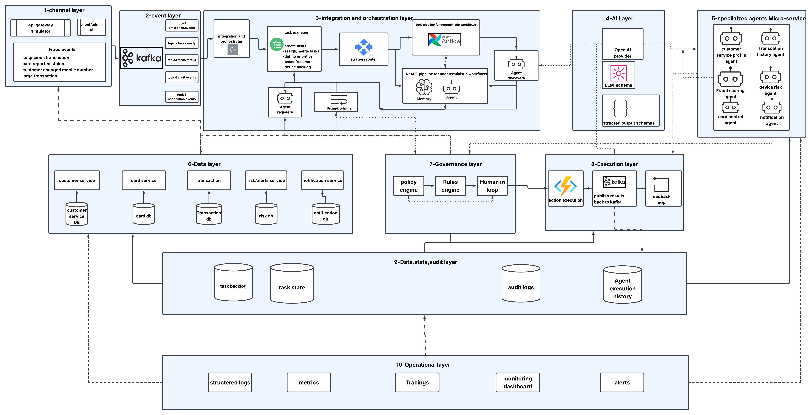

# Event Driven Agentic AI with DAGs and Kafka

## Overview
This repository demonstrates a Dual-Engine Pipeline for complex enterprise workflows, with a specific focus on fraud investigation and containment. It bridges the gap between traditional deterministic orchestration (Apache Airflow) and dynamic artificial intelligence agents (ReAct Pattern over Large Language Models).

## System Architecture
The system employs an event-driven microservice architecture designed for autonomous agentic fraud detection, investigation, and containment.



### Core Microservices
The system relies on a set of robust microservices to orchestrate workflows:

*   **Task Manager** (`:8002`): A stateful task manager that enforces a strict lifecycle state machine and calculates priority scoring (0-100) for incoming tasks.
*   **Integration Orchestrator** (`:8003`): A saga orchestrator responsible for managing dual-path execution, delegating tasks to either an Airflow DAG or a ReAct agent based on routing rules.
*   **Strategy Router** (`:8004`): A deterministic routing engine that evaluates task context to choose the appropriate execution path (DAG versus ReAct).
*   **ReAct Orchestrator** (`:8005`): An engine that implements the Reason-Act-Observe loop, dynamically invoking specialized agents to gather evidence and make decisions.
*   **Agent Discovery** (`:8006`): A dynamic, capability-based registry where specialized agents register their schemas and descriptions.
*   **Policy Engine** (`:8020`): A rule engine that evaluates proposed actions and determines the appropriate authorization level (`AUTO_ALLOW`, `AUTO_DENY`, or `REQUIRE_APPROVAL`).
*   **Approval Service** (`:8021`): A service that manages human-in-the-loop workflows for actions that require explicit authorization.
*   **Event Simulator** (`:8030`): A service to simulate customer telemetry and generate various fraud investigation scenarios.

### Kafka Messaging Engine
Apache Kafka serves as the backbone of the event-driven architecture, utilizing specific topics for domain events:
*   `banking.business-events.v1`: Handles ingress transaction and customer telemetry data.
*   `fraud.task-events.v1`: Tracks the lifecycle updates of tasks across the system.
*   `fraud.orchestration-events.v1`: Broadcasts saga state changes and Airflow DAG execution statuses.
*   `fraud.agent-events.v1`: Collects agent invocation metrics and reasoning traces.
*   `fraud.action-events.v1`: Records side-effects and containment actions (e.g., freezing a card, notifying a customer).

### Specialized Agent Pool
The ReAct Orchestrator dynamically discovers and invokes specialized agents to perform specific investigative tasks:
*   **Customer Profile Agent**: Retrieves demographic and historical profile data for customers.
*   **Transaction History Agent**: Analyzes past transaction behavior to establish baselines and detect anomalies.
*   **Device Risk Agent**: Assesses the risk associated with the device and location originating the transaction.
*   **Fraud Scoring Agent**: Computes a holistic fraud probability score based on multiple signals.
*   **Card Control Agent**: Executes card-level actions such as temporary freezes.
*   **Notification Agent**: Manages multi-channel communication to alert customers of suspicious activities.

## Prerequisites
*   Docker and Docker Compose
*   Minimum 8GB RAM allocated to Docker (16GB is highly recommended due to the heavy orchestration stack required for the 15 microservices).
*   Python 3.12+ (only required if running services locally outside of Docker).

> **Note on Mac M-Series (Colima):** Running all microservices concurrently can heavily tax Colima/Docker virtual machines. If you experience `ERR_EMPTY_RESPONSE` from Airflow or timeout errors during installation, allocate more CPU/RAM to the VM, or start the essential services in batches.

## How to Run

1.  **Start the Infrastructure:**
    Navigate to the root directory and start the Docker environment.
    ```bash
    docker compose build
    docker compose up -d
    ```

2.  **Access the Dashboards:**
    *   **Agent Simulation Dashboard:** Open `http://localhost:8000` to interact with the system.
    *   **Airflow DAG UI:** Open `http://localhost:8080` (Credentials: `admin` / `admin123`) to monitor deterministic DAG executions.

3.  **Trigger Scenarios:**
    The Event Simulator exposes endpoints to trigger predefined workflows. You can also trigger these directly from the simulation dashboard UI.
    *   **Scenario A (Deterministic Path):** Triggers a clear-cut fraud case that is routed directly to an Airflow DAG for execution. This demonstrates a rigid, predefined pipeline handling known threat patterns.
    *   **Scenario B (Agentic Investigation):** Triggers an ambiguous fraud case with multiple suspicious signals. The Strategy Router directs this to the ReAct Orchestrator, which dynamically queries sub-agents to gather evidence, reason about the case, and determine the appropriate containment action.

## Recent Fixes
*   **Customer ID Generation Range:** Fixed the `event-simulator` to generate customer IDs that strictly match the seeded database range (`C0001` to `C0100`), preventing `404 Not Found` errors in downstream agent lookups.
*   **Dependency Management:** Pinned SQLAlchemy to version `2.0.36` across all microservices and increased `pip install` timeout and retries in Dockerfiles to improve build stability in resource-constrained environments.
*   **Python 3.12 Compatibility:** Addressed the removal of `pkg_resources` from the Python 3.12 standard library by explicitly requiring `setuptools==70.3.0` to prevent crashes in OpenTelemetry instrumentation.
*   **Airflow Timeouts:** Increased Airflow's worker master timeouts to 600 seconds in `docker-compose.yml` to accommodate slower boot times during heavy concurrent container initializations.
