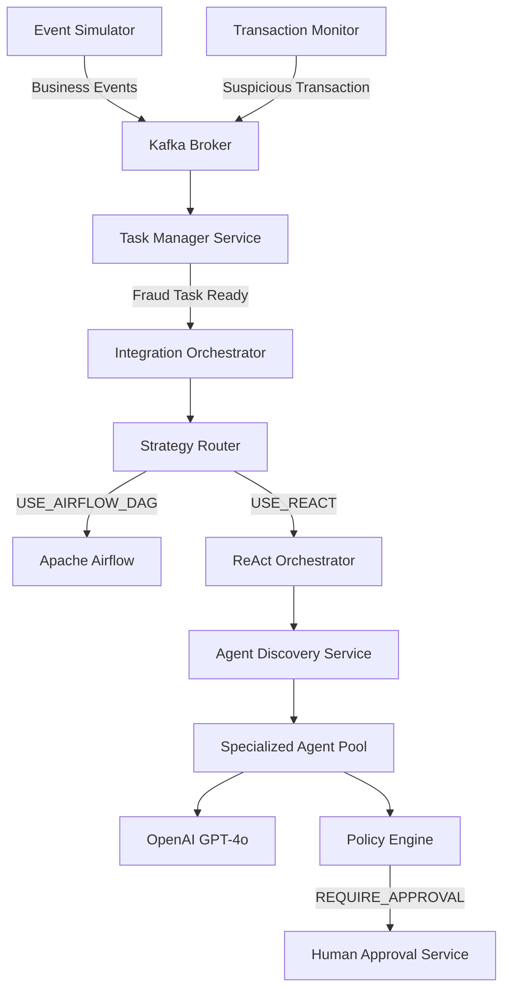

# System Architecture — Enterprise Agentic Orchestration Platform

## Overview
An event-driven microservice architecture for autonomous agentic fraud detection, investigation, and containment.

## Key Components

1. **Kafka Messaging Engine**:
   - `banking.business-events.v1`: Ingress transaction & customer telemetry.
   - `fraud.task-events.v1`: Task lifecycle updates.
   - `fraud.orchestration-events.v1`: Saga state changes & DAG executions.
   - `fraud.agent-events.v1`: Agent invocation metrics.
   - `fraud.action-events.v1`: Side-effects (card freeze, customer notification).

2. **Core Microservices**:
   - **Task Manager** (`:8002`): Stateful task manager enforcing strict lifecycle state machine and priority scoring (0–100).
   - **Integration Orchestrator** (`:8003`): Saga orchestrator managing dual-path execution (Airflow DAG vs ReAct).
   - **Strategy Router** (`:8004`): Deterministic router choosing between DAGs and ReAct.
   - **ReAct Orchestrator** (`:8005`): Reason-Act-Observe loop engine.
   - **Agent Discovery** (`:8006`): Dynamic capability-based agent registry.
   - **Policy Engine** (`:8020`): Rule engine evaluating actions (`AUTO_ALLOW`, `AUTO_DENY`, `REQUIRE_APPROVAL`).
   - **Approval Service** (`:8021`): Human-in-the-loop approval management.

3. **Specialized Agent Pool**:
   - **Customer Profile Agent** (`:8010`)
   - **Transaction History Agent** (`:8011`)
   - **Device Risk Agent** (`:8012`)
   - **Fraud Scoring Agent** (`:8013`)
   - **Card Control Agent** (`:8014`)
   - **Notification Agent** (`:8015`)
